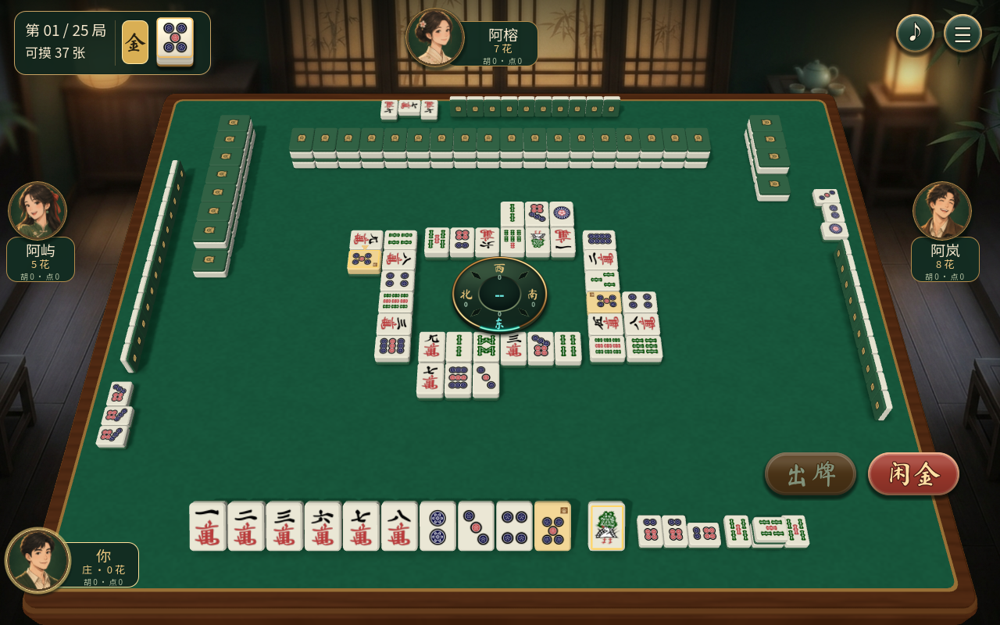

<h1 align="center">福清麻将 · 融城茶馆</h1>

<p align="center">四人福清麻将，一人也能开桌。和三名 AI 练牌，或邀朋友在局域网和 UDP 内网穿透房间里同桌。</p>

<p align="center">
  <a href="https://github.com/happiness763/fuqing-mahjong/releases/latest"><strong>下载 Windows 版</strong></a>
  · <a href="#玩法速览">玩法速览</a>
  · <a href="release/联机说明-v1.2.9.md">联机说明</a>
  · <a href="#参与开发">参与开发</a>
</p>

<p align="center">
  
</p>

## 快速开桌

从 [GitHub Releases](https://github.com/happiness763/fuqing-mahjong/releases/latest) 下载 Windows ZIP，解压后运行里面的 `FuqingMahjong-*.exe`。当前发布版为 **v1.2.9**。

| 模式 | 怎么开局 |
| --- | --- |
| **单机** | 从首页点「开始游戏」进入开桌设置，选局数（默认 25）、AI 难度和运气，再点「开始游戏」。三档难度为简单、普通、困难。 |
| **联机** | 房主开房并分享「地址:端口」。朋友填昵称、粘贴地址后加入，在大厅选东、南、西、北的空座。房主可加 AI 补齐四席，再开始游戏。 |

联机请使用同一版本。房主可设置 15 秒、30 秒、60 秒或不限时，默认 60 秒。跨网络开房需转发 UDP 端口，具体步骤见 [联机说明](release/联机说明-v1.2.9.md)。

首页「数据统计」和对局菜单里的「数据统计」可查看本机累计战绩、单局详情、最近 100 局历史和成就；数据只保存在本机。整桌结算会列出每位牌手的胡牌次数和点炮次数。

### 键鼠操作

- **出牌**。点一下选中手牌，再点同一张、按回车或点击「出牌」确认。按 Esc 可取消选择或关闭弹窗。
- **吃、碰、杠、胡、过**。能操作时，按钮出现在手牌上方。有多种吃法时，点「吃」后按牌面选组合。
- **跳过开局演出**。发牌、开金或补花演出时，点击画面或按空格。
- **换外观**。在「菜单 → 设置」切换国标或日麻皮肤，也可以导入自定义桌布。点击其他牌手头像可以发互动道具。

## 玩法速览

**胡牌需要五组加一对将。** 一组可以是同花色的三连张，如一二三万，也可以是三张相同的牌。吃、碰和杠形成的面子也计入这五组。

1. **定庄、发牌、开金。** 首局掷骰定庄。庄家起手 17 张，闲家各 16 张。翻到的牌决定本局的「金」，金可以在胡牌时当作缺少的牌来用。翻到季节牌时春夏秋冬都作金，翻到植物牌时梅兰竹菊都作金。其他花牌补掉。
2. **摸牌、出牌、争牌。** 四人按东、南、西、北的顺序轮转。吃只接上家的牌。争同一张牌时，胡优先于碰、杠，碰、杠优先于吃。多人能胡同一张牌时，牌型较高者优先，同牌型按座次。打出的金不能被认领。有人补杠时，能用第四张牌成胡的牌手可抢杠。
3. **留意过碰和过胡。** 已经得到碰或点炮胡的选项并选择「过」后，到自己实际摸牌前，别人再打相同牌面时，不能再以相同动作认领。这次自己摸到并符合胡牌条件时，仍可自摸。
4. **认清两种流局。** 牌墙保留最后 18 张，可摸的牌耗尽时流局。首巡四家各自打出的第一张牌都相同，且期间无人实际吃、碰、明杠或补杠，第四张落地就流局并自动重发本局。暗杠和补花仍可进行。

### 福清特色牌型

| 牌型 | 怎么认 |
| --- | --- |
| **闲金** | 自摸前留一张金来配将，其余牌凑齐五组。手中若有两张金，另一张可以补顺子或刻子。摸到普通牌与留出的金成将即可。 |
| **金雀、金龙** | 金雀用两张金作一对将。金龙用三张金作一副刻子。 |
| **抢金** | 开局可用桌面翻起的金成胡。闲家优先，庄家符合条件时可用一张手牌换金。 |
| **报听金坎** | 例如五万是金，满足听牌条件时可以亮出四万和六万报听。报听后摸打，直到自摸金补成四五六万胡牌。 |

<details>
<summary>计分与庄家轮转</summary>

平胡分 **P = 底分 + 花分 + 普通金张数 + 2 × 花金张数**。胡家是庄家时底分为 3，闲家为 1。花牌、明杠和补杠各计 1 花，暗杠计 2 花。

| 胡法或牌型 | 各支付方计分 |
| --- | ---: |
| 平胡 | P |
| 自摸、抢杠 | 2P |
| 闲金 | 2P + 10 |
| 三金倒、抢金、碰碰胡 | 3P |
| 金雀、金坎 | 4P + 40 |
| 金龙、天胡、正清、单吊 | 5P + 50 |

同一手牌符合多个牌型时取最高分。点炮由出牌者付分，抢杠由被抢杠者付分，自摸与特殊开局胡法由另外三家付分。庄家胡或流局连庄，闲家胡则由庄家下家接庄。

</details>

游戏内的「玩法规则」可以查到庄家上家无金时的碰杠限制、锁牌和其他细则。

## 参与开发

用 Godot **4.7.2** 导入 [godot/project.godot](godot/project.godot)，按 **F5** 运行。Windows 打包使用项目里的 **Windows Desktop** 预设，并安装同版本的导出模板。

| 模块 | 文件 |
| --- | --- |
| 牌型与计分 | [rules.gd](godot/scripts/rules.gd) |
| 牌局流程 | [game.gd](godot/scripts/game.gd) |
| AI 选牌 | [opponent.gd](godot/scripts/opponent.gd) |
| 房间与同步 | [online_room.gd](godot/scripts/online_room.gd) |
| 测试 | [godot/tests/](godot/tests/) |

从 `main` 建立功能分支后提交 Pull Request。请附上操作或复现步骤以及测试结果。改动争牌、抢杠或结算时，验证单机和联机两条入口。报错可在 [GitHub Issues](https://github.com/happiness763/fuqing-mahjong/issues) 提交游戏版本和复现步骤。

<details>
<summary>运行回归测试</summary>

从仓库根目录执行。若 `godot` 未加入 PATH，请换成 Godot 可执行文件的路径。

```text
godot --headless --path godot --editor --import
godot --headless --path godot --script res://tests/v122_game_test.gd
godot --headless --path godot --script res://tests/v122_scoring_test.gd
godot --headless --path godot --script res://tests/win_pattern_test.gd
godot --headless --path godot --script res://tests/v124_opening_test.gd
godot --headless --path godot --script res://tests/v128_idle_test.gd
godot --headless --path godot --script res://tests/v128_redeal_test.gd
godot --headless --path godot --script res://tests/v128_ai_test.gd
godot --headless --path godot --script res://tests/v128_redeal_desktop_test.gd
godot --headless --path godot --script res://tests/v127_center_test.gd
godot --headless --path godot --script res://tests/v126_pass_test.gd
godot --headless --path godot --script res://tests/v126_wall_test.gd
godot --headless --path godot --script res://tests/v126_dice_test.gd
godot --headless --path godot --script res://tests/v126_interaction_test.gd
godot --headless --path godot --script res://tests/online_rules_test.gd
godot --headless --path godot --script res://tests/online_room_test.gd
```

早期网页版源代码见 `index.html`、`src/` 和 `test/`，测试可用 `node --test`。

</details>

[更新说明](release/更新说明-v1.2.9.md) · [数据统计与首页设计](docs/superpowers/specs/2026-11-17-godot-mahjong-v1.2.9-design.md) · [牌面来源](godot/assets/tiles/CREDITS.md) · [第三方许可](release/licenses/)
