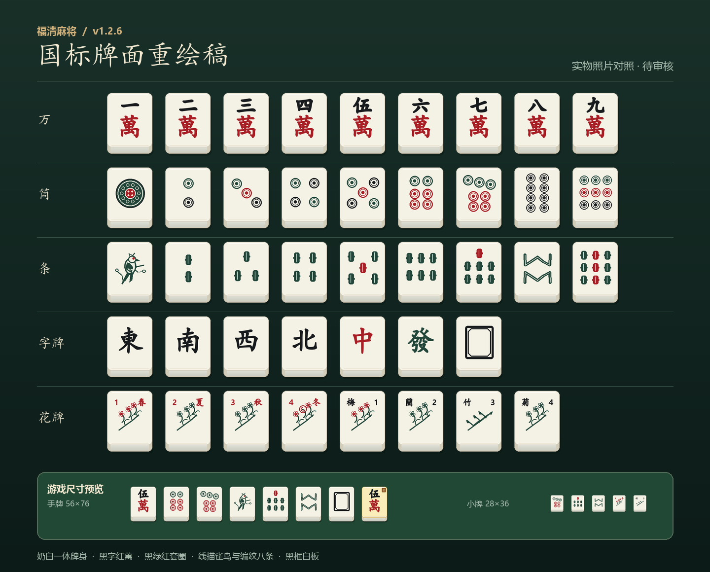

# 福清麻将 · 融城茶馆 v1.2.6 更新设计

**2026 年 11 月 15 日 · 已确认**

基于 v1.2.5a，更新骰子与牌墙的呈现，加入头像互动与过牌限制，并重绘国标皮肤。第 4 节附有正式重绘前使用的国标样稿。

## 1. 缩小骰子与立体翻滚

- 两枚骰子留在桌心。以当前约 46×46 像素的单枚正面为基准，拟缩到约 **35×35 像素**，并同比缩小点阵、阴影及两枚骰子的间距。
- 桌心圆环随骰子缩小，为四周的牌墙留出位置。定庄和开金都使用同一套立体投掷动画。
- 两枚骰子短距离掷出，各自绕不同轴翻转，落桌时轻弹一两次，随后减速停稳。翻滚时可以看到顶面、侧面以及随高度变化的影子。拟用约 **0.6–0.8 秒**，活动范围留在牌墙内侧。
- 在现有 2D 牌桌上嵌入一块透明的小型 3D 视口。用六面带点数的骰子模型和分段旋转关键帧实现掷出、弹跳、减速与落定。牌局逻辑先确定点数，最后一段平滑收至对应的朝上面。联机由承载端提供结果，各端播放动画，定庄与翻金使用一致的点数。[Godot SubViewport 文档](https://docs.godotengine.org/en/stable/classes/class_subviewport.html) · [Godot Quaternion 文档](https://docs.godotengine.org/en/stable/classes/class_quaternion.html)
- 开金在骰子落定后才从牌墙翻牌。跳过演出时直接显示最终点数和对应墙面。若缩小窗口后点数不清晰，优先调整点阵间距、镜头角度及光照。

## 2. 骰子四周的动态牌墙

牌墙以四边围合的双层牌墩呈现，置于桌心与四家的弃牌区之间。开局整副 144 张可表示为四边各 18 墩，每墩两张。近、远两边横排，左右两边转向；单张被取走后保留半墩。牌背使用低饱和色，放在骰子和牌面操作的下方，避开牌河、金牌及自定义桌布上的操作区域。

| 牌局动作 | 牌墙的变化 |
| --- | --- |
| 开局发牌 | 从当前逻辑牌头按发牌批次取牌。四轮各家四张，再发庄家最后一张。跳过开局动画时，直接显示发牌后的正确墙面。 |
| 掷骰开金 | 按现有骰点计算的位置，从对应牌墩取出桌面金，原位置留出缺口，金牌移动到现有金牌区。 |
| 普通摸牌 | 从牌头取一张。自己的牌面滑入手牌，其他座位的摸牌动画使用牌背。 |
| 补花、杠后补牌 | 从牌尾取牌，每次实际取一张减一张。补到非金花时先展示花牌，再从牌尾补；花金按现有规则进入手牌。抢杠成功后，牌墙保持补杠宣告前的数量。 |
| 牌墙剩 18 张 | 牌墙仍显示最后 18 张，余牌标注「可摸 0 张」。是否继续响应当前弃牌或进入流局，沿用现行规则。 |

实现时为每张墙牌设置公开的固定槽位。实际发牌、翻金、摸牌和补牌产生对应的槽位消耗事件，避免用总余牌数猜测应从哪一端减牌。联机以承载端为准，同步公开的槽位与取牌方向。未翻开的牌面和其他玩家的非公开摸牌仍只显示牌背。重连、跳过演出或客户端落后时，以最新状态重建墙面，旧动画结束后也不能覆盖新状态。

## 3. 头像互动

对局中，点击其他真人或 AI 的座位头像，展开一排带图标和文字的小按钮。点选道具即播放，点击空白处或按 Esc 收起。菜单靠近目标头像，通过边缘避让保持在窗口内；出牌、吃碰杠胡和结算界面优先接收操作。

操作手感参考腾讯《欢乐斗地主》的局内趣味互动，使用本项目自绘图标和短动画。下表为本项目的五种道具设计。[腾讯欢乐斗地主官方应用页](https://apps.apple.com/cn/app/id446324234)

| 道具 | 拟用画面 |
| --- | --- |
| 丢鸡蛋 | 鸡蛋沿弧线飞向头像，弹开一小圈蛋壳碎片。 |
| 送鲜花 | 花束飞到头像旁，展开后飘落几片花瓣。 |
| 倒水桶 | 小桶在头像上方倾斜，水花向两侧散开。 |
| 丢炸弹 | 卡通炸弹在目标旁弹一下，化成星形和烟团。 |
| 丢番茄 | 番茄撞到头像边缘，短暂化成红色飞溅。 |

- 单机由玩家选择 AI 目标。联机中，每位真人都能选择其他真人或 AI。AI 在本版作为互动对象，收到后的动画由客户端播放。
- 道具免费使用，仅产生视觉和音效。拟每人 **2 秒冷却**，动画约 **0.8–1.2 秒**，效果集中在头像附近。
- 联机由承载端确认发送者、目标座位、道具和冷却，再把该次事件同步给本桌玩家。动画独立于牌局计时和发牌流程，也不改变积分。断线前的动画在重连时不补播。
- 增加本机「显示互动特效」开关，默认开启，写入已有配置；音效跟随游戏的声音设置。

## 4. 国标皮肤重绘设计与审核稿

以用户提供的中式实物麻将照片作为造型基准。牌体采用奶白一体材质、圆角与轻微倒角，侧边只用明暗表现厚度。牌面保留照片里墨黑、深绿和朱红的印色，图案集中在牌面中上部。每张牌正视重绘，校正照片里的透视和光线差异。

| 牌种 | 重绘口径 |
| --- | --- |
| 万 | 上黑下红，笔画加粗并保留手写收锋。五万沿用照片的「伍萬」写法。 |
| 筒 | 一筒使用深绿色大花圈、朱红中心。二至九筒使用同心套圈，以黑、深绿、朱红排列。六筒为上二绿、下四红；七筒为上三绿、下四红；八筒黑色两列；九筒自上往下为绿、红、黑三排。 |
| 条 | 一条是细长站姿、深绿线描、带红眼的雀鸟。普通竹节为深绿，五条中央一节为红。七条为上方一红、下方六绿。八条保留照片中上下两排的折线编纹，九条中列为红。 |
| 字牌 | 東南西北用墨黑，中用朱红，發用深绿。白板采用黑色双框，内框切角，中心留白。 |
| 花牌 | 照片可见的冬、竹采用角标数字及简洁枝叶线描。其余六张沿用相同的老式印花构图补绘，保留对应的花字和 1–4 编号。 |

样稿覆盖当前游戏的 **42 种牌面**，底部给出 56×76 手牌和 28×36 小牌的缩放对照。金牌继续用游戏的淡金底和角标标识。审核时重点看「伍萬」字形、六筒和七筒的点数分组、一条雀鸟、七条与编纹八条，以及黑框白板是否贴近照片。

确认外观后，按此稿制作独立的透明牌面资源，与奶白牌体叠合，并逐张核对牌号。正式牌面使用自绘或可再分发的素材，手牌、弃牌、副露和结算共用同一套资源。设置继续保留「国标」「日麻」两个选项，已保存为国标的玩家更新后使用审核通过的新版国标牌面。

## 5. 过碰不碰、过胡不胡

系统按**座位、牌面和动作**分别记录过碰与过胡。牌面指相同花色和点数，例如别人先后打出的两张五万均视为同一牌面。

| 触发情形 | 本次摸牌前的限制 |
| --- | --- |
| 其他玩家打出一张牌，本人实际获得「碰」选项并选择「过」 | 再有人打出相同牌面，本人不能碰。 |
| 其他玩家打出一张牌，本人实际获得「胡」选项并选择「过」 | 再有人打出相同牌面，本人不能点炮胡。 |

- 本人实际从牌墙摸过一张牌后，解除自己的过碰、过胡记录。若这一圈因吃、碰等操作改变了行牌顺序，仍以本人实际摸牌为准。换局时清空记录。
- 过胡只限制接别人再次打出的同牌。本人摸到同一牌面且符合自摸条件时，可以自摸。
- 如果当前实际开放的选项同时包含碰和胡，点「过」分别记录两项。如果因其他人优先而始终没轮到本人响应，则本人未放弃该选项。联机超时按现有规则自动「过」，只记录当时已开放的选项。
- 真人与 AI 共用这套判定，单机与联机一致。联机由承载端处理，等待阶段保留匿名提示。

例：甲打五万，乙有五万对子但点了「过」。乙摸牌前，无论哪一席再打五万，乙都不能碰。乙从牌墙摸过一次后，若仍满足碰牌条件，再有别人打五万即可碰。过胡同理，若乙自己摸到五万并符合普通自摸条件，当次即可自摸。

## 6. 验收

| 项目 | 通过条件 |
| --- | --- |
| 骰子与布局 | 定庄和开金都能看到连续的多轴翻面与落桌减速。骰子在墙内落定，顶面与牌局点数一致。正常及缩小窗口下均能读出停稳的点数，翻金在落定后触发，联机和跳过演出时结果一致。四边牌墙与骰子、牌河、手牌及状态面板不重叠。 |
| 牌墙同步 | 核对开局、翻金、连续补花、三种杠、抢杠、留尾和下一局。墙牌数量与实际牌墙一致，补花演出结束时手牌稳定。 |
| 联机重连 | 两端播放同一次公开取牌动作。重连或跳过开局时，墙面恢复至当前状态，未翻牌一直显示牌背。 |
| 头像互动 | 单机能向三名 AI 发送五类道具。联机真人可对真人或 AI 发送，两端正确显示发送和接收座位，互动期间计时正常。 |
| 国标皮肤 | 样稿经确认后，按照片核对特殊牌面及 42 个牌号，用手牌和小牌两种尺寸检查点数、图案和金牌角标，并验证切换和重启恢复。 |
| 过碰、过胡 | 覆盖同牌、异牌、摸牌后恢复和摸到同牌自摸。插入一次吃碰改变座次，确认限制持续到本人摸牌。验证未轮到的候选项、同时开放的碰胡以及联机超时自动过。 |
