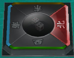
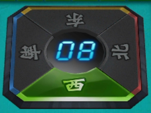

# 福清麻将 · 融城茶馆 v1.2.7 更新设计

**2026 年 11 月 15 日 · 待确认**

本版基于 v1.2.6，增加东西南北选座，重排牌墙，并将联机出牌倒计时移到桌心。两张参考图用于确定牌墙、牌河与桌心的位置关系，以及方向盘有无读秒的两种状态。

| 无倒数 | 有倒数 |
| --- | --- |
|  |  |

## 一、东西南北座位

座位以 **东 → 南 → 西 → 北** 的顺序围桌排列。单机玩家默认坐东，其余三席由 AI 补齐。联机创建房间时，创建者默认坐东。定庄和轮庄沿用现行规则，庄家在自己的方位旁另标「庄」。例如西座掷骰成为庄家，牌桌上仍显示「西 · 庄」。

每位玩家的手牌都在自己屏幕下方，四个方向字随视角一起转动。头像、桌心和积分栏使用同一套方位。

| 本人座位 | 屏幕下方 | 屏幕右侧 | 屏幕上方 | 屏幕左侧 |
| --- | --- | --- | --- | --- |
| 东 | 东 | 南 | 西 | 北 |
| 南 | 南 | 西 | 北 | 东 |
| 西 | 西 | 北 | 东 | 南 |
| 北 | 北 | 东 | 南 | 西 |

联机大厅把「1–4 号座」改成「东、南、西、北」。建议入房时暂坐第一个空座，入房后点「换到此座」即可选择其他空位。在加入前预选方位也能实现，但房间外看不到实时空座；在大厅选座可直接看到真人、AI 和空位。

- 普通玩家可自行换到空座。两人同时选同一空座，以承载端先收到的有效请求为准。另一人留在原位，收到「该座位已有人」提示。
- 房主可把自己、其他玩家或 AI 移到空座，也可交换两个已占座位。交换作为一次操作同步给全员，玩家昵称、重连身份和 AI 难度随各自移动。管理权限随房主本人，转交权限时双方继续坐原位。承载端按连接身份查找玩家当前座位，创建房间的电脑换到其他席也继续承载房间。
- 掷骰定庄开始时锁定座位，返回房间大厅后可再次调座。断线重连恢复承载端保留的座位，若房主在大厅调整过，以调整后的方位为准。既有开局条件为四席就绪，座位布局调整后仍按这一条件开局。

## 二、牌墙比例与排布

参考两张图，把牌墙从骰子附近移到**牌河外侧**。从桌心往外依次是方向盘或骰子、四家的牌河、四边牌墙、各席手牌和副露所在的区域。牌河仍直接放在桌布上，四条牌墙之间留出转角空隙。

- 每边仍为 18 墩，每墩两张。以现有 1280×800 的界面为基准，近、远两边整墙初拟约 450–520 像素长，左右两边约 360–430 像素长。按实际桌面空位微调，牌墙与手牌、头像、右上金牌及操作按钮留出间距。
- 单墩绘成横放的麻将牌，牌背有完整的长方形轮廓。两层用奶白侧面和绿色牌背区分厚度。四边统一牌厚和比例，侧墙随边转向，近边可比远边略大。继续使用现有 2D 桌面与立体牌体绘制，既有骰子保留 3D 动画。
- 发牌、翻金、摸牌和补牌继续消耗实际槽位。取掉上层能看见下层，取完后留空，余下牌墩保持原位。只剩 18 张时，保留尾牌并显示「可摸 0 张」。联机各端按自己的视角转动同一堵牌墙，补花、杠后补牌和重连时都从实际槽位恢复。

## 三、桌心方向盘与联机倒计时

桌心以牌桌中心为准，四边显示对应的东、南、西、北，中间留给读秒。有效行牌期间，高亮公开的出牌方位。争牌、抢杠等需要保密的等待阶段统一使用中性样式，可显示剩余秒数，方向盘不指向等待对象。

| 场景 | 桌心显示 |
| --- | --- |
| 定庄、发牌、掷骰开金、开局补花 | 保留开局演出及骰子；开局演出结束或跳过后切换方向盘。 |
| 联机限时对局 | 方向盘覆盖骰子，居中显示大号秒数，例如 `08`。15、30、60 秒及默认 60 秒沿用现有设置。 |
| 单机、联机不限时 | 使用图 1 的无倒数状态，方向盘保留四个方位和公开回合高亮，中央留空。 |
| 重连、结算 | 重连时停显旧秒数，连回后采用承载端同步的剩余时间。结算时停显秒数。 |

倒计时继续以承载端为准。开局或补花的演出留时不计入界面显示的出牌秒数，提早跳过演出时，读数最高为房主设置的秒数。超时后的自动动作沿用现行规则。多种吃法弹窗可显示同一份计时，抢杠候选牌移到手牌上方的操作区，方便同时看到候选牌和桌心。

## 验收场景

| 项目 | 核对内容 |
| --- | --- |
| 座位与庄家 | 单机玩家和新建房间的创建者默认在东。让南、西、北各自入座，核对四视角与积分栏。庄家换人时，仅「庄」标记移动。 |
| 联机选座 | 两人争同一空座只有一人成功。房主可调换真人与 AI，AI 难度和真人身份随座位移动。核对转交房主、换座后重连，以及开局锁座。 |
| 牌墙 | 检查完整牌墙、半墩、连续补花及留尾 18 张。在 1280×800 和 864×540 下，核对四边比例及牌墙、牌河、动作区的间距。 |
| 桌心 | 检查开局骰子、跳过演出、有限与不限时、吃牌组合、抢杠、重连和结算。两端方向正确，计时相差不超过正常网络延迟和显示取整，争牌界面不显示待响应方位。 |
