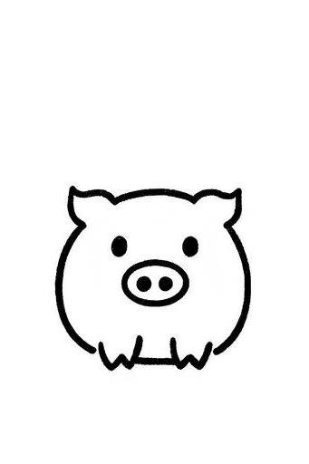

# 福清麻将 v1.3.2 牌背图案设计

**2026 年 11 月 22 日 · 已确认**

在现有绿色牌背上加入可爱、简洁的图案。同一副牌使用同一种图案，每次重新发牌切换下一款，按固定次序循环。

## 1. 图案风格

以用户提供的小猪为造型参考。采用圆润、略带手绘感的轮廓，五官使用实心点和短线，保留足够留白。图案居中，以浅色块配深色轮廓，在绿色牌背上保持辨识度。

参考图展示了小猪的圆脸、小耳朵、点状眼睛和椭圆鼻子。正式制作时按牌背尺寸重新绘制轮廓，简化耳朵、脚等细节，优先保留脸部特征。图案内不加文字。

首批采用以下六款，均使用相同的线条粗细、主体占比和印色。

| 顺序 | 图案 | 主要特征 |
| --- | --- | --- |
| 1 | 小猪 | 圆脸、小耳朵、椭圆鼻子，参考所附示例。 |
| 2 | 小猫 | 圆脸、三角耳朵，左右各一两笔胡须。 |
| 3 | 兔子 | 圆脸、两只长耳朵，点状眼睛。 |
| 4 | 小熊 | 圆脸、两只圆耳朵、小鼻子。 |
| 5 | 小鸡 | 圆身、小冠和短喙，突出整体轮廓。 |
| 6 | 小狗 | 圆脸、垂耳和小鼻子。 |

## 2. 每副牌循环

拟从小猪开始，依次显示小猫、兔子、小熊、小鸡和小狗，再回到小猪。一副牌内每张牌背都使用当前图案，摸牌、补花、杠后补牌、暂停和刷新画面时保持该款。

- 正常进入下一局时切换下一款。
- 首巡四家同牌流局后重发，视为新一副牌，也切换下一款。即使局号相同，也只在真正重新发牌时推进一次。
- 联机以承载端发布的发牌序号确定图案。更换座位只改变观看方向，重连后恢复当前款式。普通快照更新、移交房主和重复收到消息均保持本副款式。
- 新开一桌重新从小猪开始。

“按副循环”、首巡重发推进和新桌从小猪开始按此方案执行。

## 3. 显示位置与适配

| 位置 | 图案显示 |
| --- | --- |
| 四边双层牌墙 | 每张露出的牌背使用当副图案，侧墙随牌体转向。下层被上层遮住的部分按牌墩的遮挡关系绘制。 |
| 发牌、摸牌和补牌的背面动画 | 飞行中的背面使用同一款，翻到正面后显示原有牌面。 |
| 开金翻牌前 | 使用当副图案，翻开后显示实际金牌。 |
| 其他以背面表示的牌张 | 复用同一套牌背绘制，避免出现一桌混用新旧背面的情况。 |

图案控制在牌背内侧的安全区域，避开倒角、高光和牌身。按牌背可用宽高等比缩放并居中。侧墙的牌背转向后，五官与脸型仍保持正常比例。

当前牌墙单张较小，缩到 864×540 窗口后，优先呈现脸型和耳朵等轮廓。极小的飞行牌背可以简化五官，主体与配色继续对应当前款式。国标、日麻两种正面皮肤共用这组牌背。

海底牌的高亮边框继续位于图案外侧，摸牌来源、牌墩层次和取走后的空位要清楚可见。

## 4. 接入方案

图案使用本项目自绘的矢量素材，由牌墙和单张牌背共用。六款组成固定列表，依据共享发牌序号选取，避免各个动画或客户端分别选款。

结合现有 table_wall.gd 的牌墙绘制、tile_view.gd 的背面分支和 table.gd 的背面动画入口接入。复用现有 hand_id 区分下一局与同局号下的重新发牌。

## 5. 验收

- 连续发七副牌，依次显示六款并回到小猪。一副牌内牌墙、飞行牌和开金背面一致。
- 核对首巡流局重发、普通结算后的下一局及新开一桌，图案按确定的时机推进。
- 联机四个视角显示同一款，侧墙方向正确。重连、房主转交和连续刷新后仍显示当前图案。
- 在 1280×800 和 864×540 下检查六款，轮廓可辨认，图案完整地位于牌背内。
- 同时检查半墩、补牌和海底高亮，确保图案随实际牌张出现及消失。
