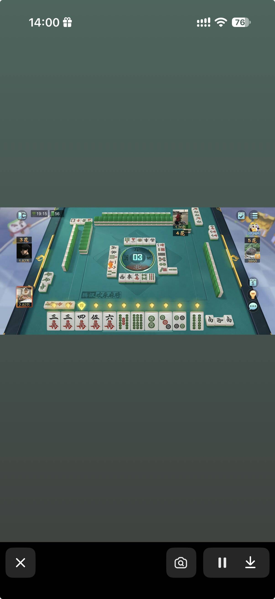

# 福清麻将 v1.3.3 玩家视角优化设计

**v1.3.3 返工 · 按已展示的效果图复核**

参考用户提供的牌桌画面，优化本家手牌、副露、舍牌和牌墙之间的位置与朝向，让玩家看牌时更接近坐在麻将桌旁的视角。

## 1. 参考图与当前问题

参考图中，本家手牌靠近屏幕下沿，副露放在手牌右侧，四家的舍牌围绕风盘排布。远侧牌墙较窄，两侧牌墙沿桌边向远处延伸，牌桌有近宽远窄的纵深。

本次取其中横向游戏画面作为参考。画面外的手机状态栏、图片查看按钮和上下留白属于截图外层。

当前舍牌已有四向旋转，主要需要调整以下位置。

| 位置 | 当前表现 | 本版目标 |
| --- | --- | --- |
| 本家副露 | 固定放在手牌上方，副露多时另起一排。 | 靠近手牌右侧，和暗手形成完整的一组本家牌。 |
| 左右家副露 | 主要按屏幕横向画牌，与各家的坐向脱节。 | 沿各自桌边排列，牌面朝向所属牌手。 |
| 对家副露 | 仍使用与本家类似的正向牌面。 | 转向对家，和其舍牌、牌墙形成一致朝向。 |
| 牌墙与桌面 | 四边以规则矩形围合，远近差异较小。 | 温和的近大远小与桌边倾斜，保持牌墙层次清楚。 |

## 2. 推荐的视角方案

按效果图采用 **带厚度的透视牌桌**。桌框铺满视口，绿色桌布随近宽远窄的桌面收拢。牌墙放到桌边，副露放在墙内侧，圆形风盘居中偏上，四席使用独立圆形头像。手牌保持正视与清晰的点击区域。

各侧牌墙沿透视边线排列，牌背、牌身、叠层和投影分别绘制。实机牌墙以剩余牌槽为准，发牌后可见牌墙会随牌局减少。

## 3. 本家手牌与副露

本家手牌、摸入牌和副露共用屏幕下方的安全区域。

- 手牌保持清晰正向和较大的点击面积。选中牌向上抬起，摸入牌与其余手牌留一小段间隔。
- 吃碰杠后的副露放在暗手右侧，使用平放牌体，比可操作手牌略小。整组本家牌根据暗手和副露的总宽度居中，组与组之间留出间隔。
- 先计算所有组的实际宽度，再分配位置。副露较多、暗手变少时，仍尽量排在同一条牌带中。以实际可达的暗手与副露组合验证最大占宽。
- 明杠、暗杠和补杠保留各自外观及来源横牌。补杠叠在原横牌上方，并预留叠牌高度。暗杠继续遵守已有的背面显示规则。
- 报听金坎的亮牌靠近本家牌组，有独立标记，操作按钮仍在手牌上方的可用区域。

## 4. 四家朝向与牌桌分区

| 观看位置 | 牌面朝向与副露排布 |
| --- | --- |
| 本家，下方 | 牌字正向，副露沿下边横排。 |
| 右家，右侧 | 牌字相对本家旋转 270°，副露沿右边纵向排布。 |
| 对家，上方 | 牌字旋转 180°，副露沿上边横排。 |
| 左家，左侧 | 牌字旋转 90°，副露沿左边纵向排布。 |

旋转角度采用 Godot 屏幕坐标约定，与现有舍牌方向一致。以每家自己的观看方向解释“横放的来源牌”，再叠加该家整体朝向，确保吃、碰和杠的来源仍能辨认。

从桌心向外依次安排风盘、舍牌、牌墙及牌手区域。头像和花数靠近对应桌边，避开副露的扩展位置。正常对局按现有信息权限显示，结算亮牌时也使用各家所属的朝向。

舍牌沿用每行六张和固定牌面尺寸。同一座位的舍牌沿用各自取景尺寸，新增舍牌时已有牌张保持原位和大小。最后一张舍牌的提示留在其所属位置。

## 5. 牌墙、风盘与动画

- 四边双层牌墙沿桌边布置。近边更宽、远边更窄，侧墙向桌面远端收拢。各墩上下两层共用相同的透视比例和位置关系。
- 六款动物牌背随牌体方向旋转，主体等比显示。海底牌边框位于牌背外侧，半墩、剩余牌和取空后的空位清楚可辨。
- 风盘仍在桌心。四向标记、分数和倒计时与本家视角对应。
- 发牌、摸牌、补花、出牌和吃碰杠后的落位动画使用新区域的位置，飞行起点和实际牌墙槽位一致。
- 自定义桌布适配新的桌面范围，木框和边缘阴影呈现斜向桌边的厚度。

联机各端仍从自己的座位观看牌桌。换座后的本家始终在下方，同一副露的来牌来源在四个视角下都对应同一位牌手。

## 6. 窗口与触摸适配

以 1280×800 作为布局基准，核对 864×540 及常见横屏比例。沿用项目现有的缩放和移动端布局机制，根据窗口比例协调区域间距。

本家手牌点击区域与可见牌体一致，选择、取消、出牌和浮动操作按钮在缩小后仍可使用。浮动按钮、海底提示、报听亮牌、动作提示和结算弹窗都纳入遮挡检查。操作按钮在近侧牌墙与手牌之间靠右横向排列，海底提示放到左下空区。

## 7. 验收

| 场景 | 验证内容 |
| --- | --- |
| 本家牌组 | 起手 17 张、普通摸打、吃碰后暗手减少，以及多副露组合均完整可见。摸入牌、选中牌和副露不重叠。 |
| 吃碰杠 | 四家各做吃、碰、明杠、暗杠和补杠，核对整体朝向、来源横牌及补杠叠牌。 |
| 舍牌 | 从第一张增加到多行，固定大小和旧位置稳定，每行六张，四家顺序与方向正确。 |
| 牌墙 | 检查发牌、取上层、取下层、补牌、最后几墩和海底边框，图案、厚度、阴影无错位或悬空。 |
| 联机视角 | 四个座位分别进入游戏，核对自己的手牌在下方，对手副露、来源和舍牌方向正确。 |
| 特殊阶段 | 报听金坎、争牌、抢杠、首巡重发、海底、断线重连和结算亮牌均正确落位。 |
| 屏幕与交互 | 在正常窗口、小窗口和横屏触摸布局下验证点击区域、动画终点和界面遮挡。 |
